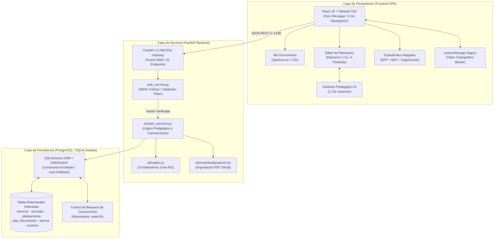
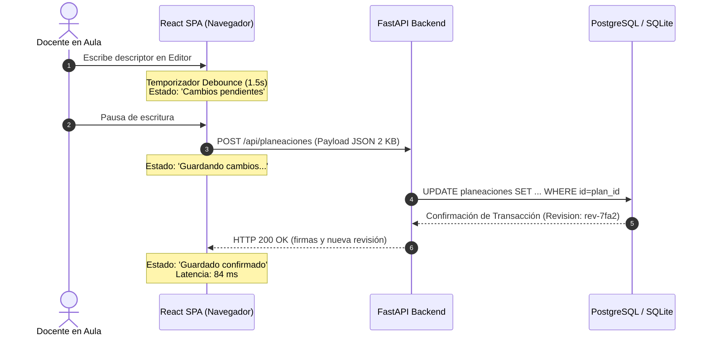

# ARQUITECTURA DE SOFTWARE — USAER 2E 2.0

> **Modelo de Arquitectura:** Desacoplada de 3 Capas (SPA React 18 + API REST FastAPI + Base Relacional PostgreSQL / SQLite)  
> **Patrón de Persistencia:** Domain-Driven Services + SQLAlchemy ORM con Pool Acotado y Bloqueos de Concurrencia  
> **Costo de Operación:** $0.00 MXN adicionales durante desarrollo y pruebas  

---

## 1. DIAGRAMA ARQUITECTÓNICO INTEGRAL

---

## 2. SEPARACIÓN ESTRICTA DE RESPONSABILIDADES

### A. Frontend (React 18 SPA)
- **Tecnología:** React 18, Tailwind CSS, Babel Standalone / Bundler estático minimalista.
- **Responsabilidad:** Renderizado client-side inmediato, manejo del estado reactivo de edición, debouncing de autoguardado (1,500 ms), filtrado instantáneo en memoria sobre arrays ya transferidos (0 ms de latencia percibida).
- **Seguridad en Cliente:** Eliminación total de almacenamiento de expedientes completos en `localStorage` plano. Únicamente se conserva el token Bearer en `sessionStorage`, el cual se purga automáticamente al cerrar el navegador o invocar el botón de Salir.

### B. Backend (Python / FastAPI)
- **Tecnología:** FastAPI, Pydantic v2, Starlette.
- **Responsabilidad:** 
  1. **Autenticación Criptográfica:** Emisión de tokens de portador de 32 bytes aleatorios generados mediante `secrets.token_urlsafe(32)`.
  2. **Control de Acceso Basado en Roles (RBAC):** Verificación estricta en cada petición de las escuelas asignadas al docente (`user.escuelas_permitidas`). Un docente asignado a `ESC-001` no puede consultar ni modificar alumnos de `ESC-002`.
  3. **Control de Concurrencia:** Asignación de hash de revisión atómico (`rev-xxxxxx`) en cada guardado de planeación y EPP, previniendo sobrescrituras ciegas.
  4. **Servicios de Asistencia Pedagógica:** Inyección de contexto educativo real del alumno sin enviar expedientes reales a servicios externos sin consentimiento.

### C. Persistencia Relacional (PostgreSQL / SQLite Aislado)
- **Tecnología:** PostgreSQL 16 con Neon / SQLite local protegido (`data/usaer_local.db`).
- **Control de Conexiones:** Motor SQLAlchemy configurado con `SafeSession` que garantiza cierre forzoso inmediato en bloques `try...finally` y `pool_pre_ping=True`, evitando fugas de conexiones como las sufridas anteriormente en Streamlit.
- **Esquema:** Integridad referencial con índices primarios en `id`, `curp`, `id_escuela`, `cuenta`, y marcas de tiempo UTC.

---

## 3. CONTRATO DE CONCURRENCIA PARA 25 DOCENTES SIMULTÁNEOS

