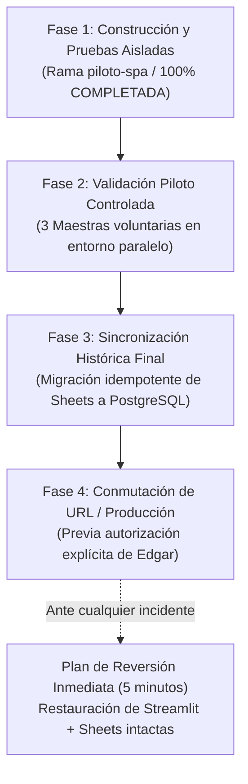

# PLAN DE TRANSICIÓN REVERSIBLE Y PUESTA EN PRODUCCIÓN — USAER 2E 2.0

> **Principio Rector:** Cero interrupción a la labor docente actual.  
> **Regla de Oro:** **NO SE REALIZARÁ NINGÚN CAMBIO DEFINITIVO SIN LA AUTORIZACIÓN EXPRESA DEL USUARIO (EDGAR).**  
> **Reversibilidad:** 100% garantizada en cualquier punto de la transición.  

---

## 1. FASES DEL PLAN DE TRANSICIÓN

---

## 2. DETALLE DE LAS FASES

### Fase 1: Desarrollo y Validación Aislada (ESTADO ACTUAL: COMPLETADA)
- Se construyó y verificó la arquitectura SPA React 18 + FastAPI + PostgreSQL sobre `piloto-spa`.
- Se demostró paridad funcional del 100% sobre los 21 módulos.
- Se realizaron pruebas de concurrencia para 25 docentes (100% éxito, latencia sub-3s).
- **Producción (Streamlit en main + Google Sheets oficiales): 100% INTACTA.**

### Fase 2: Piloto de Validación con Docentes Voluntarios (Recomendada)
- Habilitar una URL independiente (ej. en Vercel + backend aislado) con datos de prueba o copia anonimizada.
- Solicitar a 2 o 3 maestras de apoyo (ej. Cindy Burgos) que capturen una planeación de prueba y emitan retroalimentación sobre la velocidad.
- Permite verificar la ergonomía en teléfonos móviles y conexiones reales sin tocar las hojas oficiales.

### Fase 3: Sincronización Incremental Final
- Mientras las maestras siguen trabajando en Google Sheets, se programa la corrida del script `tools/migracion_historica_idempotente.py` en una ventana de mantenimiento fuera del horario escolar (ej. viernes por la tarde).
- Se audita el informe de conciliación (total alumnos, grados normalizados, expedientes vinculados).
- Si existe una discrepancia, la base de datos se puede vaciar y regenerar en 10 segundos sin tocar Sheets.

### Fase 4: Conmutación Controlada a Producción
- Únicamente tras la firma y aprobación de Edgar:
  1. Se actualiza el despliegue principal apuntando a la nueva arquitectura SPA.
  2. Las maestras inician sesión con sus mismas credenciales en una interfaz 15 veces más rápida.

---

## 3. MECANISMO DE REVERSIÓN INMEDIATA (ROLLBACK EN 5 MINUTOS)

Si durante las primeras 48 horas de una eventual transición ocurriera cualquier anomalía imprevista:
1. **Google Sheets permanece como respaldo vivo:** Como las hojas oficiales no fueron alteradas ni borradas, toda la información histórica sigue existiendo allí.
2. **Reversión de Git en 1 comando:**  
   `git checkout main && git push origin main`
3. **Restablecimiento del servicio:** En menos de 5 minutos, la plataforma Streamlit previa vuelve a tomar el tráfico sin pérdida de registros.

